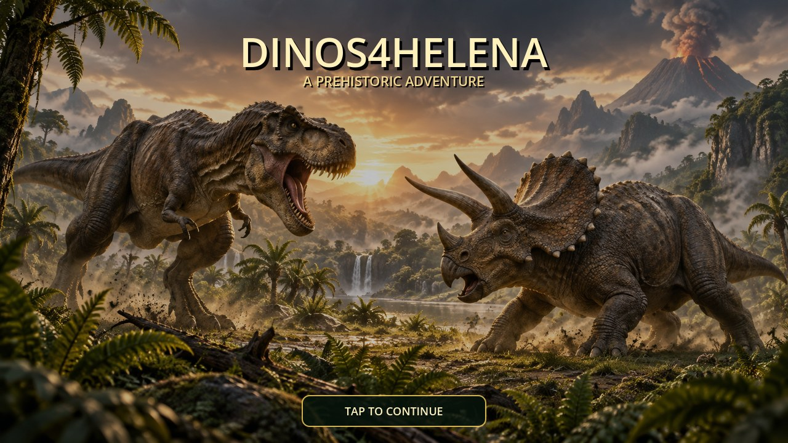
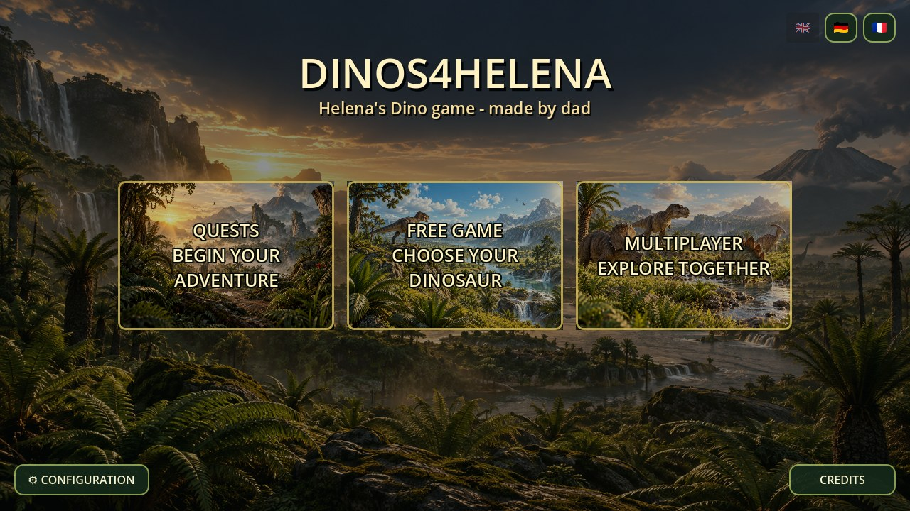
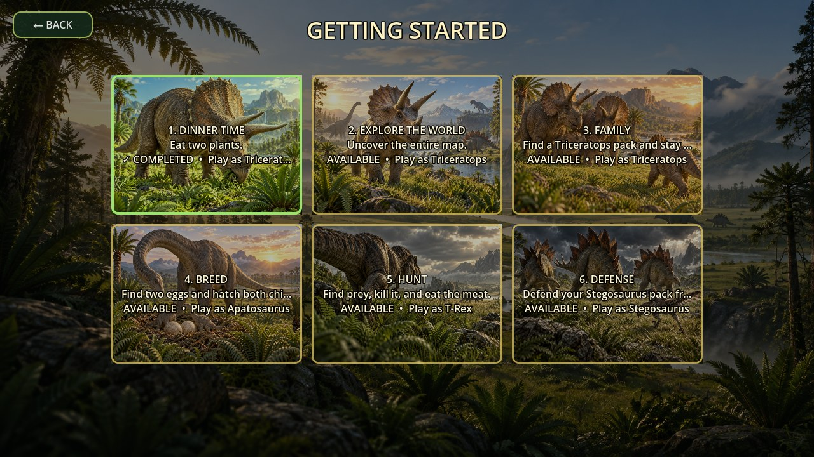
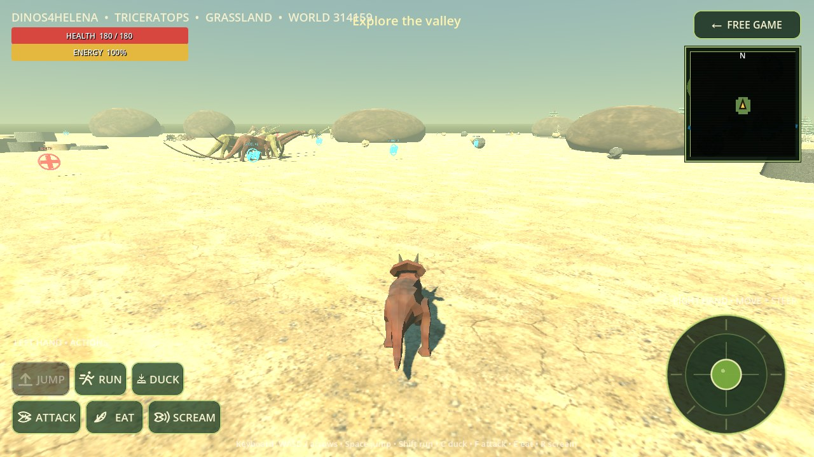
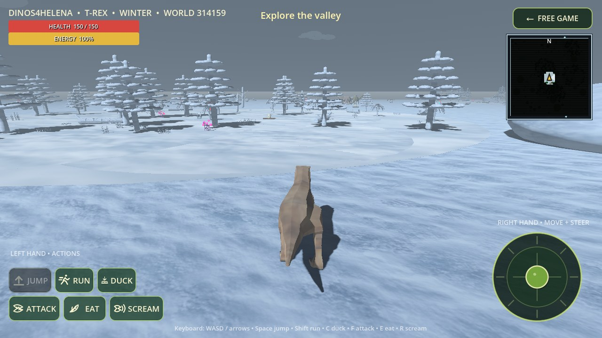

# Dinos4Helena

[Visit the game website and field guides](https://keuperj.github.io/Dinos4Helena/)

Play as one of seven dinosaurs in a 3D survival game for Android and desktop. Graze with a herd, hunt for your next meal, or find a nest and hatch a baby that follows you around the valley.

## Quick install

**Android:** If you have a Dinos4Helena APK from a trusted source, open it on your phone, tap **Install**, then **Open**. If you don’t have the APK yet, the [full installation guide](docs/INSTALL.md) shows how to build it or play on a Linux computer instead.

## Choose how to play

- **Quests:** Start with the *Getting Started* missions to learn how to find food and stay safe.
- **Free Game:** Pick a dinosaur and explore at your own pace. Save the six-digit world seed if you want to revisit the same landscape.
- **Multiplayer:** Join a shared world and explore with friends.

For your first adventure, choose **Quests → Getting Started → Dinner Time** to learn how to graze as a Triceratops.

| Exploring the grassland | Roaming the winter map |
| --- | --- |
|  |  |

See the [player guide](docs/PLAY_GUIDE.md) for controls and survival tips. To run the game from source, host a game, or make a mission, see the [development guide](docs/DEVELOPMENT.md), [multiplayer server guide](server/README.md), or [quest-writing guide](docs/QUEST_AUTHORING.md).

## Creators

Created by [Studio Level 6128](https://studio-level-6128.github.io/website/).